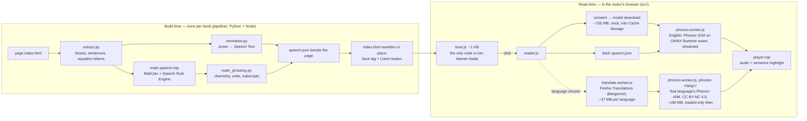

# libretext-reader-web

## Listen Mode for LibreTexts: how it works and why

Listen Mode reads any LibreTexts page aloud and highlights each sentence as it's spoken. The voice runs entirely in the reader's own browser. No audio is made on a server, and nothing about what a student reads or hears leaves their device.

### The approach, and why we chose it

- **Speech made in the browser, not on a server.** Pre-recording every LibreTexts page in English alone would mean about 306,000 hours of audio and 2.3–3.3 TB of files, plus a re-record every time a page is edited. Doing it in the browser costs nothing per listen, stays current with every edit, and keeps reading private.
- **The page is prepared once, ahead of time.** A build step writes a small "speech script" next to each page. It holds what the reader sees (left untouched) and what the voice should say: years read as years, "et al." spelled out, long citations shortened, tables announced instead of read cell by cell.
- **Nothing loads unless you ask for it.** Visitors who never press *Enter Reader Mode* get a tiny 1 KB script. The voice downloads only after the reader agrees to it, and the download size is shown up front.

### Old model vs. new model

We started with **Supertonic**. We replaced it with **Phonon** from Gradium:

| | Supertonic (old) | Phonon (current) |
|---|---|---|
| English download | ~410 MB | ~160 MB, plus a 15–26 MB engine the first time |
| Time to first sound | about 5–14 seconds | almost instant once the voice is loaded (under a tenth of a second) |
| Speed | baseline | about 2.3x faster |
| Accuracy | similar | similar |
| English licence | OpenRAIL-M | Apache 2.0 (open) |

**Languages:** English, French, German, Spanish and Portuguese, each with a male and a female voice. Pages are translated in the browser by Mozilla's Firefox Translations (the same engine and models Firefox uses), then spoken. The four non-English voices are licensed for non-commercial use, so they stay demo-only until Gradium confirms in writing that we may use them. English has no such restriction.

### Does closing the browser mean downloading again?

No. The voice is saved in the browser's own storage the first time. It's checked for damage before every use, and the browser is asked to keep it. Closing or force-quitting the browser only means loading the saved voice back into memory, which takes a few seconds on a fast computer. A new download happens only in a private/incognito window, after the reader clears their site data, or if the browser frees up space on its own.

### Equations

The page still shows equations with the site's usual MathJax. For the voice, every equation is turned into spoken words ahead of time with MathJax and the Speech Rule Engine (the same open-source tools behind MathJax's accessibility features), using the ClearSpeak reading style. Our own rules fix chemistry, units and subscripts on top of that. While it plays, each equation is highlighted as one piece. In translated readings, equations are still spoken in English.

### MP3 download

On the listening page, a local test page where you type or paste text, readers can save a passage as an MP3. The same audio that plays is converted to MP3 right in the browser, so no server is involved. Save turns on as soon as the voice has finished preparing the audio, often while it is still playing, and it saves the whole passage. It stays off if a reading was stopped or failed. Book pages currently offer listening only.

## How it works

A build step walks a book's pages and, for each one, writes a `speech.json` beside the
page: every sentence in two forms.

- **Display Text** — what the reader sees. Never modified. Highlighting wraps existing DOM
  nodes in a span; it never replaces, re-renders, or rewrites the text on the page.
- **Speech Text** — what the voice says. Computed once, in the pipeline, not derived at read
  time. Years read as years, `et al.` expands, long citations compress, tables are announced
  rather than read cell by cell.
- **Equations** — a `\( … \)` or `\[ … \]` span is recorded as a `[[latex:<base64>]]` token in
  Display Text and spoken in words (Speech Rule Engine, Clearspeak) in Speech Text. MathJax
  rewrites the span at typeset time, so the reader treats each `<mjx-container>` as one atom
  whose text is that token. Every translated track speaks the equation in English.
- **Images** — an image with a real description is read as "Image: <alt text>", in page order
  (so before its caption), and outlined while it is spoken; the image itself is never wrapped
  or changed. Empty alt (decorative), `role="presentation"`, and alt that is only a filename,
  a placeholder word or MindTouch's `mindtouch.page#thumbnail` stay silent (LT-537). A
  `\( … \)` formula in the alt becomes a math token like any other and is spoken in words;
  the reader decodes the token to match it against the raw alt, which MathJax never typesets.

At read time a ~1 KB boot script is all that loads. Pressing *Enter Reader Mode* is the
first moment anything else is fetched: the reader consents to the model download, the page
strips to a reading view, and each sentence highlights as it is spoken.

Inference never runs on the main thread. It is multi-second work; on the main thread the
page would freeze mid-scroll. A long task over 100 ms during playback is treated as a bug.

## Workflow

Two halves, joined only by files on disk. The left half runs once per book on a
build machine and needs Python and Node. The right half runs in the visitor's browser
and needs a static file server with the right headers.



What each edge carries:

| from → to | what crosses | where it is defined |
|---|---|---|
| page → `speech.json` | every sentence as Display Text + Speech Text, with character offsets into the page's own text so highlighting can find it | `pipeline/tts_manifest.py` `build_manifest()` |
| `speech.json` → reader | fetched relative to the page URL, so it is always `<page>/speech.json` | `src/reader.mjs` `loadSpeechManifest()` |
| reader → speech worker | one sentence of Speech Text at a time, four to eight ahead of playback | `src/player.mjs` |
| `phonon/manifest.json` → English voice download | name, path, size and sha256 of each model file, plus the pinned Hub revision; the download is verified against it | `scripts/fetch-phonon.py` |
| `phonon-<lang>/manifest.json` → translation voice download | the same shape, for fr, de, es or pt, plus the pinned Ollama ID it was built from; its size is what the language menu and the consent box add to the model's | `scripts/stage-phonon-lang.py` |

The pipeline never runs in the browser and the browser never runs the pipeline. If a
sentence sounds wrong, the fix is in `pipeline/` and the page is rebuilt; nothing in
`src/` decides what words are said.

## Putting it on a library

This is the handoff checklist. Everything below is what the staging mirror does today,
generalised. Budget about a day for a first deployment, most of it waiting on model
conversion and the first book build.

The asset root `/_assets/tts/` is **an absolute path, hard-coded** — in files
under `src/` and `pipeline/`, in `vite.config.js` and in several scripts
(`grep -rl _assets/tts src pipeline scripts vite.config.js` lists them). Serve it at
that path, or change every one of them in a single commit.

### 1. Build the reader and stage the models

```bash
npm install                      # devDependencies are needed: the math bridge runs at build time
python3.13 -m venv .venv         # any Python 3.10+, by name; see *Running it* below
.venv/bin/pip install -r pipeline/requirements.txt
npm run build                    # → dist/_assets/tts/
```

Stage the English voice with `python3 scripts/fetch-phonon.py <dir>/phonon`: it fetches
[Phonon 31M](https://huggingface.co/onnx-community/phonon-31m-en-ONNX) at a pinned revision,
checks every file against a pinned size and sha256, and writes `phonon/manifest.json`.
Stage each translation voice with
`python3 scripts/stage-phonon-lang.py <lang> <dir>/phonon-<lang>` (fr, de, es, pt): it
builds that language's Phonon 40M from the Ollama copy `phonon:<lang>` (pinned by its
Ollama ID) into the two ONNX graphs the browser runs, with the Male and Female voices,
`voices/M1.bin` and `voices/F1.bin` (LT-222): one is the copy's own default voice, the
other comes from the voice catalogue in `phonon:40m-<lang>` (also pinned), so both
`ollama pull phonon:<lang>` and `ollama pull phonon:40m-<lang>` must have run first. It
needs numpy and onnx, and refuses a target inside this repository, because those weights
are CC BY-NC 4.0. The weights are not in this repository (see *Model weights* below).
Then lay out the served directory:

```
/_assets/tts/
├── boot.js  reader.js  models.js  qa.js  reader.css                    from dist/
├── phonon.worker.js  translate.worker.js  transformers.web.js           from dist/
├── phonon/                  English voice (~155 MB): scripts/fetch-phonon.py <this dir>/phonon
├── phonon-fr/ phonon-de/    one Phonon 40M per translation language (~190 MB each):
├── phonon-es/ phonon-pt/      scripts/stage-phonon-lang.py <lang> <this dir>/phonon-<lang>
├── ort-mt/                  onnxruntime-web wasm, for Phonon
└── mt/                      optional: bergamot/ (the engine), one directory per language pair, pairs.json
```

`scripts/stage-local.sh` does exactly this into `.stage/` (or `STAGE=<dir>`) and is the
reference for the copy order, including how it picks the right `ort-mt/` binaries out of `node_modules`:
they must be the version transformers.js bundles, because another version's wasm
aborts inside its JS with no readable error. It ends by running
`node scripts/check-no-supertonic.mjs` on the staged directory, which fails if any file
Supertonic used (its root `manifest.json`, `onnx/` and `ort/`; its worker, its four
networks and `voice_styles/` at any depth) or any code pointing at one is still there;
CI runs the same check on the build. Listen mode
runs Phonon only (LT-217), so a mirror that served Supertonic should delete those paths
when it deploys this.

Translation is optional. To ship it, run `node scripts/fetch-mt-models.mjs` once (Node 22.15 or
newer; ~37 MB per pair plus a 5 MB engine shared by all of them, written to
`bench/assets/mt-bergamot/`) and copy its output to `mt/`, then stage each
language's voice. Serve a pair only with its `phonon-<lang>/`: no other engine speaks
a translation, and the reader offers every language in `mt/pairs.json` that it has a
voice entry for. It reads each voice's manifest only to size the download, and still
offers a language whose manifest does not load. `stage-local.sh`
stages the four voices when `STAGE` is outside the repository (it skips them for the
default `.stage/`, which is inside it), leaves out a language whose voice fails to
build, and prunes `mt/pairs.json` to the languages that have one. Without `mt/` the
language menu does not appear.

`PAGES_FROM=<dir>` makes `stage-local.sh` copy the books from an existing stage instead
of fetching them from the mirror, and rebuild only `_assets/tts/`.

`ASSETS_ONLY=1` stages only `_assets/tts/` and stops: no books, nothing fetched from the
mirror (it still builds, and fetches English Phonon from the Hub). Like every run, it
deletes `STAGE` first, books included, so point it at a directory of its own. The
mirror's deploy script, kept outside this repo, uses it, so what it uploads is this layout.

`PHONON_LANGS` picks which translation voices to stage (default `fr de es pt`; an
empty value stages none). A language left out is pruned from `mt/pairs.json` too.

### 2. Give each page the hook

The pipeline converts `<div class="reader-link">…</div>` — an affordance the mirror's
page template already emits — into the Listen button, and adds one tag before `</head>`:

```html
<button type="button" id="tts-enter" class="reader-link">Enter Reader Mode</button>
<script defer src="/_assets/tts/boot.js"></script>
```

That is the entire contract with the page. On a static mirror, the pipeline writes it.
On a CMS that renders pages dynamically, put the button and the tag in the skin
yourself and call `build_manifest(html, page_id, title)` from `pipeline/tts_manifest.py`
to produce the `speech.json` that must be served at `<page>/speech.json`. `install()`
and `uninstall()` are mirror-specific (they walk `index.html` files on disk);
`build_manifest()` is not.

### 3. Build the book

A book is opted in by name — `ALLOWED_BOOKS` in `pipeline/tts_manifest.py`. That list is
a constant in code, not a flag or an argument, because the pipeline rewrites `index.html`
in place and re-pulling from the source is the only undo. Adding a book is a human edit,
reviewed as a diff.

```bash
.venv/bin/python -m pipeline.tts_manifest <site-root>/<book> --site-root <site-root>
.venv/bin/python -m pipeline.tts_manifest <site-root>/<book> --site-root <site-root> --uninstall
```

`install` writes a `speech.json` beside every page and injects the boot script; `--uninstall`
returns every page to what the source produced. A page with nothing readable — a chapter
landing page, front matter — is left exactly as found, and un-injected if a previous run
got there. Re-running over an already-built book is safe and idempotent.

`CHEMISTRY_BOOKS`, in the same file, marks a book whose every equation is chemistry. That
is not a nicety: the per-equation heuristics cannot tell `N_2` from an algebraic subscript,
so without it one page reads the same molecule two different ways. See
`docs/SPEAKING_MATHEMATICS.md` §4.

The Speech Rule Engine bridge is one Node process for the whole book, so a build is
minutes, not hours. Translation (`pipeline.translate_cli`) is a separate, slower pass
per language and is only needed if you ship `mt/`.

### 4. Send the headers

Four header rules, and each one has been the cause of a silent failure. Copy them from
the mirror's Caddyfile rather than re-deriving them:

```caddyfile
@tts      path /_assets/tts/*
@ttsscope path /<book>/* /_assets/tts/*
@book {
    path /<book>/*                            # every book that carries the reader
    not path /<book>/<page with an iframe>/*  # see below
}

# 1. Cross-origin isolation on the PAGE → SharedArrayBuffer → multi-threaded wasm.
#    Without it the engine still boots, single-threaded, and RTF goes 0.41 → 0.91.
header @book Cross-Origin-Opener-Policy   "same-origin"
header @book Cross-Origin-Embedder-Policy "require-corp"

# 2. A worker spawned from an isolated document must itself carry COEP,
#    or the browser refuses to instantiate it (ERR_BLOCKED_BY_RESPONSE).
header @tts  Cross-Origin-Embedder-Policy "require-corp"
header @tts  Cross-Origin-Resource-Policy "same-origin"

# 3. CSP additions, scoped to the book and the assets. Nothing else changes.
#    'wasm-unsafe-eval'  WebAssembly may compile
#    worker-src blob:    ONNX Runtime spawns its worker from a blob URL
#    script-src blob:    and its wasm threads importScripts() from blob URLs
header @ttsscope Content-Security-Policy "default-src 'self'; script-src 'self' 'wasm-unsafe-eval' blob:; worker-src 'self' blob:; style-src 'self'; img-src 'self'; font-src 'self'; media-src 'self'; connect-src 'self'; object-src 'none'; base-uri 'self'; form-action 'self'"

# 4. Models are content-addressed → immutable. The CODE is not: reader.js is
#    imported on click, which a hard refresh does not bypass, so an immutable
#    reader.js keeps a returning visitor on the old bundle for a year.
#    Phonon's weights and voices are immutable; its manifest, config and
#    tokenizer are small and revalidate with the code.
#    Each voice directory is named, not globbed: Caddy reads a path ending in *
#    as a plain prefix, so phonon-*/onnx/* would match nothing. One line each,
#    since a Caddyfile has no line continuation.
@ttsmodels path /_assets/tts/phonon/onnx/* /_assets/tts/phonon/voices/* /_assets/tts/phonon-fr/onnx/* /_assets/tts/phonon-fr/voices/* /_assets/tts/phonon-de/onnx/* /_assets/tts/phonon-de/voices/* /_assets/tts/phonon-es/onnx/* /_assets/tts/phonon-es/voices/* /_assets/tts/phonon-pt/onnx/* /_assets/tts/phonon-pt/voices/*
@ttscode {
    path /_assets/tts/*
    not path /_assets/tts/phonon/onnx/* /_assets/tts/phonon/voices/* /_assets/tts/phonon-fr/onnx/* /_assets/tts/phonon-fr/voices/* /_assets/tts/phonon-de/onnx/* /_assets/tts/phonon-de/voices/* /_assets/tts/phonon-es/onnx/* /_assets/tts/phonon-es/voices/* /_assets/tts/phonon-pt/onnx/* /_assets/tts/phonon-pt/voices/*
}
header @ttsmodels Cache-Control "public, max-age=31536000, immutable"
header @ttscode   Cache-Control "public, max-age=0, must-revalidate"
```

Two things to check against your own site before pasting. **A page with a cross-origin
`<iframe>` cannot be isolated**: COEP blocks any frame whose own response does not send
COEP, and a YouTube or ADAPT embed does not. Find them (`grep -rl '<iframe' <book>`) and
exclude those paths from `@book`; the reader still works there, single-threaded. Images and
other subresources are only a concern if your CSP currently lets them load cross-origin —
if `img-src 'self'` already blocks them, isolation costs nothing more. And `.wasm` must be
served as `application/wasm` or ONNX Runtime refuses to stream-compile it.

### 5. Verify, then listen

```bash
SMOKE_BASE=https://<host> SMOKE_BOOK=<book> SMOKE_PAGE=/<book>/<a page>/ bash scripts/smoke.sh
node scripts/math-audit.mjs --url https://<host>/<book>/<a page with equations>/
```

`smoke.sh` checks the things above (button, `speech.json` offsets, the page's isolation
headers and CSP, scope), that the worker answers 200 with its own COEP and CORP, that each
language's manifest names both models and both voices and answers 200 with every file it
names, that the models and voices are cached for a year and the code and the manifests
revalidate (a header alone proves nothing: Caddy sends it on a 404 too). It checks English and the four translations; a host that serves English only
sets `SMOKE_VOICES=phonon`. It prints `SMOKE_OK`, or one line per check that failed. Then open a page, press
*Enter Reader Mode*, accept the download, press ▶, and listen — see *Checking that it
sounds right* for why that last step is not optional.

### Rolling back

`--uninstall` on the book is exact and takes seconds: every page returns byte-identical to
its source and `speech.json` is removed. The headers and the staged assets are left in
place on purpose — with no page carrying the boot tag they are never requested, and
removing them is a separate, human decision.

The voices roll back by directory. Each language's `phonon-<lang>/` and its `mt/en-<lang>/`
pair are self-contained, so removing one and its entry in `mt/pairs.json` takes that
language off the menu without touching the others. A reader who already downloaded it
keeps its files in Cache Storage until the site clears them; they are never fetched again.
Restoring a previous stage of `/_assets/tts/` as a whole is the full rollback; the
reader's code and its voices are versioned together, so restore them together.

## Porting the equation speech to another stack

**[`docs/SPEAKING_MATHEMATICS.md`](docs/SPEAKING_MATHEMATICS.md)** is the reference for
speaking equations and chemistry aloud, written for anyone porting this to another stack.
It states each rule as a string transformation over Speech Rule Engine's output, with the
reason it exists and the measured number of equations it fixes, and it is explicit about
the parts that are easy to get wrong: which rules are safe to run unconditionally and
which are not, why the subject has to come from the book rather than the equation, why
units must be an explicit list, and the two orderings that silently do nothing if you get
them backwards.

`pipeline/math_phrasing.py` is the reference implementation of those rules;
`scripts/math-audit.mjs` renders a page of equations with their spoken form and audio so
the result can be checked by ear.

[`docs/`](docs/) indexes everything else.

## Requirements

**Cross-origin isolation is mandatory, not an optimisation.** Without `SharedArrayBuffer`
the wasm backend runs single-threaded and measured real-time factor goes from 0.410 to
0.912 — past the 0.500 budget, which means playback cannot keep pace with itself. The
serving origin must send `Cross-Origin-Opener-Policy: same-origin` and
`Cross-Origin-Embedder-Policy: require-corp` — step 4 under *Putting it on a library*
has the full set, and the failure is silent: the engine boots and simply cannot keep up.

**It needs a reasonably quick machine.** Measured under a CPU quota on four cores, the
budget is cleared only within roughly 10% of an Apple M1 Ultra-class core; at half that
per-core speed the median RTF is 0.970, which technically produces audio while never
building a buffer. Peak memory during synthesis is about 1.7 GB.

## Model weights are not included

English is spoken by **Phonon by Gradium, Apache 2.0**:
[`onnx-community/phonon-31m-en-ONNX`](https://huggingface.co/onnx-community/phonon-31m-en-ONNX),
an export of `gradium/phonon-31m-en`, with the Preston and Hadley voices. Its weights
(about 155 MB) are **not** in this repository; `scripts/fetch-phonon.py` fetches them at a
pinned revision into `bench/assets/` (gitignored) when `npm run stage` runs.

French, German, Spanish and Portuguese are spoken by **Phonon by Gradium, CC BY-NC 4.0**:
each language's own 40M checkpoint (`phonon:fr`, `phonon:de`, `phonon:es`, `phonon:pt` in
Ollama), run in the browser. Each language's Male voice is its checkpoint's own default
voice, under the same CC BY-NC licence. Its Female voice file is an Apache 2.0 voice from
[`gradium/phonon-voices`](https://huggingface.co/gradium/phonon-voices), read from the language's
`phonon:40m-<lang>` Ollama copy; `bench/phonon/FINDINGS.md` "LT-222" says which. Both voices
are spoken by the CC BY-NC model, so the reader credits them as "Voice model: Phonon 40M by
Gradium, CC BY-NC 4.0. Male voice: the model's own. Female voice: from Gradium's phonon-voices,
Apache 2.0." `scripts/stage-phonon-lang.py`
builds the browser files from a pinned Ollama copy at stage time, outside this
repository; they are never committed. A reader who only ever listens in English never
downloads them, and one who picks a language downloads only that language's. They may
run on the staging mirror, a demo on its own domain; they go public only once Gradium
has confirmed in writing that this use is noncommercial. Listen mode stays free, with no
paywall, ads or member-only access.

This project's own code is **MIT**, see `LICENSE`. That covers everything in `src/`,
`pipeline/`, `scripts/` and `tests/`.

It does **not** cover the voices. The CC BY-NC 4.0 weights are **not MIT**: the
noncommercial terms travel with them to anyone who receives them, and they are not
distributed here — staging fetches them. Whether those terms suit a given distribution is
a legal question, not a code one, and it is not settled by this repository being MIT.

The text is translated in the browser by
[Firefox Translations](https://github.com/mozilla/firefox-translations-models), Mozilla's
own models (v3, `base-memory`) run by its Bergamot engine
([bergamot-translator](https://github.com/mozilla/bergamot-translator), a wasm build of
Marian). Models and engine are both **MPL-2.0**. The engine's JavaScript glue is vendored
unchanged in `src/vendor/bergamot/` with its licence; `vite.config.js` turns it into an ES
module at build time. Every file is pinned, with Mozilla's own sha256 before and after
decompression, in `scripts/mt-models.lock.json`, and `scripts/fetch-mt-models.mjs` stops
on any mismatch. The files are fetched from Firefox's attachment CDN when staging and
served from our own origin; a reader's browser never contacts Mozilla. Like the voices,
none of these files is committed.

It replaced Opus-MT (LT-255) after a benchmark (LT-252) in which it scored higher in all
four languages (COMET-22 83.2 against 80.7 on news text; about half as many badly wrong
sentences on 472 textbook sentences), at a third of the download and about six times the
speed. `scripts/convert-mt-models.py`, which staged Opus-MT for the browser, is kept only
for the Opus-MT comparison tools.

Supertonic, which spoke the translations until LT-217, is gone from Listen mode entirely,
with no fallback in any language.

Nor does the MIT licence cover `bench/phonon/listen/vendor/lamejs/`: lamejs 1.2.1, the MP3 encoder
behind the local listening page's Save button, is **LGPL-3.0**. It is kept as an
unmodified file of its own with its licence texts beside it, pinned by sha256, and never
bundled into this project's code; see the README in that folder.

Equation speech is produced at build time by [Speech Rule Engine](https://github.com/Speech-Rule-Engine/speech-rule-engine)
and [MathJax](https://github.com/mathjax/MathJax-src) (`mathjax-full`), both **Apache-2.0**.
They run under Node in the pipeline only; nothing from either ships to the browser.

## Layout

```
src/        browser code — ES modules, no framework
pipeline/   the build step — Python
scripts/    staging, local serving, measurement, auditing
tests/      vitest unit tests and Playwright end-to-end
docs/       the implementation reference and the decision record
bench/      measurement harnesses (their outputs are gitignored)
```

## Running it

`npm install --omit=dev` is not enough to build: `mathjax-full` and `speech-rule-engine`
are devDependencies (nothing from either ships to the browser) but the pipeline's math
bridge (`scripts/math-speech.mjs`) requires both at build time, and an `--omit=dev`
install gives it a `node` that dies on module resolution the moment a page has an
equation.

It needs Node 22 and Python 3.10 or newer; CI runs 3.13. Make the virtualenv with a
named interpreter, such as `python3.13` or `python3.12`: on a Mac, plain `python3` is often
the system's 3.9, and with it staging stops in the pipeline with
`TypeError: unsupported operand type(s) for |`. On an Intel Mac use 3.12, since `torch`
has no 3.13 build there. `npm run stage` and `npm run serve` both call `.venv/bin/python`,
so the virtualenv must exist first.

```bash
npm install
python3.13 -m venv .venv         # or python3.12 etc.: any 3.10+, named
.venv/bin/pip install -r pipeline/requirements.txt
npm run build

npm run stage      # build a local copy of a real page + assets into .stage/
npm run serve      # serve it with the COOP/COEP headers production sends
```

Then open
<http://127.0.0.1:8788/social_psychology/13%3A_Competition_and_Cooperation_in_Our_Social_Worlds/13.01%3A_Conflict_Cooperation_Morality_and_Fairness/>
and press *Enter Reader Mode*. `BOOK_NAME`, `PAGE_URL` and `PAGE_DIR` stage a different
page: `PAGE_URL` is the page on the mirror, and `PAGE_DIR` is its path below the book,
decoded (`:` for `%3A`, `(` for `%28`). The book must be one of the four in `ALLOWED_BOOKS`
(`pipeline/tts_manifest.py`: `social_psychology`, `math_elem_teachers`, `chem_4b`,
`human_relations`); the pipeline refuses any other, and `npm run serve` isolates only those.

A fresh clone stages English only, and two messages say so; both are expected:

- `==> no translation models to stage`: the Firefox Translations files come from
  `node scripts/fetch-mt-models.mjs` and are not in the repository, so there is no
  `mt/pairs.json`, and the browser logs a 404 for `/_assets/tts/mt/pairs.json`.
- `(skipped: STAGE is inside the repo; …)`: the fr/de/es/pt voices are spoken by a
  CC BY-NC 4.0 model, built from local Ollama copies and staged only outside the
  repository (see *Model weights* above).

## Tests

```bash
npx vitest run                       # browser modules
.venv/bin/python -m pytest pipeline/tests -q   # the build step
npx playwright test                  # end to end, needs a staged copy
```

The 100 ms long-task limit, the 0.500 RTF budget and the boot-script size cap are chosen
values, not tuning knobs. Changing one is a deliberate decision.

## Measuring on your own hardware

`scripts/measure-rtf-console.js` measures synthesis speed on any machine with nothing
installed — paste it into the browser console on a page carrying the reader and run
`await rtf()`. Note that DevTools CPU throttling will *not* give a meaningful answer here:
it throttles the main thread only, and all synthesis happens in workers.

## Checking that it sounds right

The build's own numbers do not tell you this, and it is worth being blunt about why. A page
reporting `41 spoken, 0 failed` was mispronouncing its arithmetic: `failed` counts equations
the *engine* could not convert, and is blind to equations converted into the wrong words.

```bash
node scripts/math-audit.mjs --url <page url>     # every equation: LaTeX, typeset, words, audio
bash scripts/smoke.sh                            # post-deploy check against the live site
```

`math-audit.mjs` writes a page you open and listen to. It is the only tool here that
answers "is this right?", and a human ear is still the last check — every remaining defect
found in this project was found by someone saying "that doesn't sound right" after the
automated checks passed.

`scripts/math-review.mjs` adds an advisory second opinion from a language model. It writes
a verdict column and **never** the spoken words: a model turns `0.125` into `0.25`
fluently, which in a chemistry textbook means audio that confidently contradicts the page.

## Status

Working and deployed, not finished.

- **Four books** are live on a staging mirror: `social_psychology`, `math_elem_teachers`,
  `chem_4b` and `human_relations`.
- **English** is spoken by Phonon 31M. **French, German, Spanish and Portuguese** are
  machine-translated in the browser and spoken by their own Phonon 40M (LT-216, LT-217).
  Czech, Danish, Hungarian, Italian, Dutch and Swedish were dropped with Supertonic.
- **Equations and chemistry are spoken**, not skipped.
- Both test suites run in CI on every push and pull request.

Known limits, all documented rather than hidden:

- Not validated on low-end hardware. The RTF budget assumes roughly an M1-class core.
- The translation models, which speak both voices, are CC BY-NC 4.0 (only the Female
  voice files are Apache 2.0);
  they run on the staging mirror, a demo, and are not served publicly until Gradium
  confirms the use is noncommercial.
- The translation quality gate (472 sentences, at most 2% failing) passed for all four
  with Opus-MT: Portuguese 6, German 9, French 10 and Spanish 10 failures. Firefox
  Translations, which replaced it (LT-255), had fewer badly wrong sentences in every
  language on the same 472 (LT-252).
- `docs/SPEAKING_MATHEMATICS.md` §8 lists the remaining phrasing defects.
