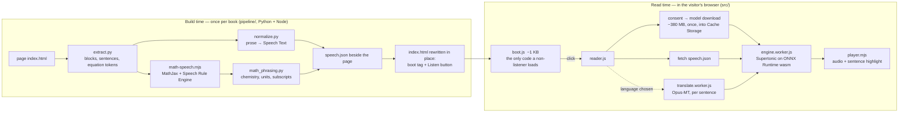

# libretext-reader-web

A listen mode for LibreTexts textbook pages. Speech is synthesised **entirely in the
reader's browser** — no audio is generated on a server, and nothing about what is read or
heard leaves the device.

Not to be confused with the desktop LibreTexts Reader, a separate Tauri + React + Rust
application. This project borrows its domain vocabulary and several algorithms; it shares
no code.

## How it works

A build step walks a book's pages and, for each one, writes a `speech.json` beside the
page: every sentence in two forms.

- **Display Text** — what the reader sees. Never modified. Highlighting wraps existing DOM
  nodes in a span; it never replaces, re-renders, or rewrites the text on the page.
- **Speech Text** — what the voice says. Computed once, in the pipeline, not derived at read
  time. Years read as years, `et al.` expands, long citations compress, tables are announced
  rather than read cell by cell.
- **Equations** — a `\( … \)` or `\[ … \]` span is recorded as a `[[latex:<base64>]]` token in
  Display Text and spoken in words (Speech Rule Engine, Clearspeak) in Speech Text. MathJax
  rewrites the span at typeset time, so the reader treats each `<mjx-container>` as one atom
  whose text is that token. Every translated track speaks the equation in English.

At read time a ~1 KB boot script is all that loads. Pressing *Enter Reader Mode* is the
first moment anything else is fetched: the reader consents to the model download, the page
strips to a reading view, and each sentence highlights as it is spoken.

Inference never runs on the main thread. It is multi-second work; on the main thread the
page would freeze mid-scroll. A long task over 100 ms during playback is treated as a bug.

## Workflow

Two halves, joined only by files on disk. The left half runs once per book on a
build machine and needs Python and Node. The right half runs in the visitor's browser
and needs a static file server with the right headers.



What each edge carries:

| from → to | what crosses | where it is defined |
|---|---|---|
| page → `speech.json` | every sentence as Display Text + Speech Text, with character offsets into the page's own text so highlighting can find it | `pipeline/tts_manifest.py` `build_manifest()` |
| `speech.json` → reader | fetched relative to the page URL, so it is always `<page>/speech.json` | `src/reader.mjs` `loadSpeechManifest()` |
| reader → engine worker | one sentence of Speech Text at a time, four to eight ahead of playback | `src/player.mjs` |
| `manifest.json` → model download | name, path, size and sha256 of each model file; the download is verified against it | `scripts/write_model_manifest.py` |

The pipeline never runs in the browser and the browser never runs the pipeline. If a
sentence sounds wrong, the fix is in `pipeline/` and the page is rebuilt; nothing in
`src/` decides what words are said.

## Putting it on a library

This is the handoff checklist. Everything below is what the staging mirror does today,
generalised. Budget about a day for a first deployment, most of it waiting on model
conversion and the first book build.

The asset root `/_assets/tts/` is **an absolute path, hard-coded** — in seven files
under `src/`, in `pipeline/tts_manifest.py`, in `vite.config.js` and in two scripts
(`grep -rl _assets/tts src pipeline scripts vite.config.js` lists them). Serve it at
that path, or change every one of them in a single commit.

### 1. Build the reader and stage the models

```bash
npm install                      # devDependencies are needed: the math bridge runs at build time
python -m venv .venv && .venv/bin/pip install -r pipeline/requirements.txt
npm run build                    # → dist/_assets/tts/
```

Fetch the [Supertonic](https://github.com/supertone-inc/supertonic) weights into
`bench/assets/` (`onnx/`, `voice_styles/`, `ort/`; they are not in this repository — see
*Model weights* below), then lay out the served directory:

```
/_assets/tts/
├── boot.js  reader.js  engine.worker.js  models.js  qa.js  reader.css   from dist/
├── translate.worker.js  transformers.web.js                             from dist/
├── manifest.json            scripts/write_model_manifest.py <this dir>
├── onnx/                    Supertonic weights (~380 MB)
├── voice_styles/            one JSON per voice
├── ort/                     onnxruntime-web 1.17 wasm, for the TTS engine
├── ort-mt/                  onnxruntime-web wasm for the translator — a DIFFERENT version
└── mt/                      optional: one directory per language pair + pairs.json
```

`scripts/stage-local.sh` does exactly this into `.stage/` and is the reference for the
copy order, including how it picks the right `ort-mt/` binaries out of `node_modules`.
The two ONNX Runtimes are not interchangeable: the TTS engine pins 1.17 and
transformers.js bundles a later one, and loading either's wasm into the other's JS
aborts inside the module with no readable error.

Translation is optional. To ship it, run `scripts/convert-mt-models.py` once (multi-GB
download, ~120 MB served per pair) and copy its output to `mt/`. Without `mt/` the
language menu simply does not appear.

### 2. Give each page the hook

The pipeline converts `<div class="reader-link">…</div>` — an affordance the mirror's
page template already emits — into the Listen button, and adds one tag before `</head>`:

```html
<button type="button" id="tts-enter" class="reader-link">Enter Reader Mode</button>
<script defer src="/_assets/tts/boot.js"></script>
```

That is the entire contract with the page. On a static mirror, the pipeline writes it.
On a CMS that renders pages dynamically, put the button and the tag in the skin
yourself and call `build_manifest(html, page_id, title)` from `pipeline/tts_manifest.py`
to produce the `speech.json` that must be served at `<page>/speech.json`. `install()`
and `uninstall()` are mirror-specific (they walk `index.html` files on disk);
`build_manifest()` is not.

### 3. Build the book

A book is opted in by name — `ALLOWED_BOOKS` in `pipeline/tts_manifest.py`. That list is
a constant in code, not a flag or an argument, because the pipeline rewrites `index.html`
in place and re-pulling from the source is the only undo. Adding a book is a human edit,
reviewed as a diff.

```bash
.venv/bin/python -m pipeline.tts_manifest <site-root>/<book> --site-root <site-root>
.venv/bin/python -m pipeline.tts_manifest <site-root>/<book> --site-root <site-root> --uninstall
```

`install` writes a `speech.json` beside every page and injects the boot script; `--uninstall`
returns every page to what the source produced. A page with nothing readable — a chapter
landing page, front matter — is left exactly as found, and un-injected if a previous run
got there. Re-running over an already-built book is safe and idempotent.

`CHEMISTRY_BOOKS`, in the same file, marks a book whose every equation is chemistry. That
is not a nicety: the per-equation heuristics cannot tell `N_2` from an algebraic subscript,
so without it one page reads the same molecule two different ways. See
`docs/SPEAKING_MATHEMATICS.md` §4.

The Speech Rule Engine bridge is one Node process for the whole book, so a build is
minutes, not hours. Translation (`pipeline.translate_cli`) is a separate, slower pass
per language and is only needed if you ship `mt/`.

### 4. Send the headers

Four header rules, and each one has been the cause of a silent failure. Copy them from
the mirror's Caddyfile rather than re-deriving them:

```caddyfile
@tts      path /_assets/tts/*
@ttsscope path /<book>/* /_assets/tts/*
@book {
    path /<book>/*                            # every book that carries the reader
    not path /<book>/<page with an iframe>/*  # see below
}

# 1. Cross-origin isolation on the PAGE → SharedArrayBuffer → multi-threaded wasm.
#    Without it the engine still boots, single-threaded, and RTF goes 0.41 → 0.91.
header @book Cross-Origin-Opener-Policy   "same-origin"
header @book Cross-Origin-Embedder-Policy "require-corp"

# 2. A worker spawned from an isolated document must itself carry COEP,
#    or the browser refuses to instantiate it (ERR_BLOCKED_BY_RESPONSE).
header @tts  Cross-Origin-Embedder-Policy "require-corp"
header @tts  Cross-Origin-Resource-Policy "same-origin"

# 3. CSP additions, scoped to the book and the assets. Nothing else changes.
#    'wasm-unsafe-eval'  WebAssembly may compile
#    worker-src blob:    ONNX Runtime spawns its worker from a blob URL
#    script-src blob:    and its wasm threads importScripts() from blob URLs
header @ttsscope Content-Security-Policy "default-src 'self'; script-src 'self' 'wasm-unsafe-eval' blob:; worker-src 'self' blob:; style-src 'self'; img-src 'self'; font-src 'self'; media-src 'self'; connect-src 'self'; object-src 'none'; base-uri 'self'; form-action 'self'"

# 4. Models are content-addressed → immutable. The CODE is not: reader.js is
#    imported on click, which a hard refresh does not bypass, so an immutable
#    reader.js keeps a returning visitor on the old bundle for a year.
@ttsmodels path /_assets/tts/onnx/* /_assets/tts/ort/* /_assets/tts/voice_styles/*
@ttscode { path /_assets/tts/*  not path /_assets/tts/onnx/* /_assets/tts/ort/* /_assets/tts/voice_styles/* }
header @ttsmodels Cache-Control "public, max-age=31536000, immutable"
header @ttscode   Cache-Control "public, max-age=0, must-revalidate"
```

Two things to check against your own site before pasting. **A page with a cross-origin
`<iframe>` cannot be isolated**: COEP blocks any frame whose own response does not send
COEP, and a YouTube or ADAPT embed does not. Find them (`grep -rl '<iframe' <book>`) and
exclude those paths from `@book`; the reader still works there, single-threaded. Images and
other subresources are only a concern if your CSP currently lets them load cross-origin —
if `img-src 'self'` already blocks them, isolation costs nothing more. And `.wasm` must be
served as `application/wasm` or ONNX Runtime refuses to stream-compile it.

### 5. Verify, then listen

```bash
SMOKE_BASE=https://<host> SMOKE_BOOK=<book> SMOKE_PAGE=/<book>/<a page>/ bash scripts/smoke.sh
node scripts/math-audit.mjs --url https://<host>/<book>/<a page with equations>/
```

`smoke.sh` checks the eight things above (button, `speech.json` offsets, every header,
scope). It prints `SMOKE_OK`, or one line per check that failed. Then open a page, press
*Enter Reader Mode*, accept the download, press ▶, and listen — see *Checking that it
sounds right* for why that last step is not optional.

### Rolling back

`--uninstall` on the book is exact and takes seconds: every page returns byte-identical to
its source and `speech.json` is removed. The headers and the staged assets are left in
place on purpose — with no page carrying the boot tag they are never requested, and
removing them is a separate, human decision.

## Porting the equation speech to another stack

**[`docs/SPEAKING_MATHEMATICS.md`](docs/SPEAKING_MATHEMATICS.md)** is the reference for
speaking equations and chemistry aloud, written for anyone porting this to another stack.
It states each rule as a string transformation over Speech Rule Engine's output, with the
reason it exists and the measured number of equations it fixes, and it is explicit about
the parts that are easy to get wrong: which rules are safe to run unconditionally and
which are not, why the subject has to come from the book rather than the equation, why
units must be an explicit list, and the two orderings that silently do nothing if you get
them backwards.

`pipeline/math_phrasing.py` is the reference implementation of those rules;
`scripts/math-audit.mjs` renders a page of equations with their spoken form and audio so
the result can be checked by ear.

[`docs/`](docs/) indexes everything else.

## Requirements

**Cross-origin isolation is mandatory, not an optimisation.** Without `SharedArrayBuffer`
the wasm backend runs single-threaded and measured real-time factor goes from 0.410 to
0.912 — past the 0.500 budget, which means playback cannot keep pace with itself. The
serving origin must send `Cross-Origin-Opener-Policy: same-origin` and
`Cross-Origin-Embedder-Policy: require-corp` — step 4 under *Putting it on a library*
has the full set, and the failure is silent: the engine boots and simply cannot keep up.

**It needs a reasonably quick machine.** Measured under a CPU quota on four cores, the
budget is cleared only within roughly 10% of an Apple M1 Ultra-class core; at half that
per-core speed the median RTF is 0.970, which technically produces audio while never
building a buffer. Peak memory during synthesis is about 1.7 GB.

## Model weights are not included

The voice is [Supertonic](https://github.com/supertone-inc/supertonic). Its weights are
roughly 380 MB and are **not** in this repository; fetch them from that project into
`bench/assets/` before running `npm run stage`.

This project's own code is **MIT**, see `LICENSE`. That covers everything in `src/`,
`pipeline/`, `scripts/` and `tests/`.

It does **not** cover the voice. `src/vendor/helper.js` is vendored from
`supertone-inc/supertonic` and carries an intact licence header naming its origin; that
sample code is MIT. The **model weights are OpenRAIL-M**, which carries behavioural-use
restrictions that propagate to anyone who receives them, and they are not distributed
here — you fetch them yourself. Whether those terms suit a given distribution is a legal
question, not a code one, and it is not settled by this repository being MIT.

Equation speech is produced at build time by [Speech Rule Engine](https://github.com/Speech-Rule-Engine/speech-rule-engine)
and [MathJax](https://github.com/mathjax/MathJax-src) (`mathjax-full`), both **Apache-2.0**.
They run under Node in the pipeline only; nothing from either ships to the browser.

## Layout

```
src/        browser code — ES modules, no framework
pipeline/   the build step — Python
scripts/    staging, local serving, measurement, auditing
tests/      vitest unit tests and Playwright end-to-end
docs/       the implementation reference and the decision record
bench/      measurement harnesses (their outputs are gitignored)
```

## Running it

`npm install --omit=dev` is not enough to build: `mathjax-full` and `speech-rule-engine`
are devDependencies (nothing from either ships to the browser) but the pipeline's math
bridge (`scripts/math-speech.mjs`) requires both at build time, and an `--omit=dev`
install gives it a `node` that dies on module resolution the moment a page has an
equation.

```bash
npm install
npm run build

npm run stage      # build a local copy of a real page + assets into .stage/
npm run serve      # serve it with the COOP/COEP headers production sends
```

Then open the staged page and press *Enter Reader Mode*.

## Tests

```bash
npx vitest run                       # browser modules
python -m pytest pipeline/tests -q   # the build step
npx playwright test                  # end to end, needs a staged copy
```

The 100 ms long-task limit, the 0.500 RTF budget and the boot-script size cap are chosen
values, not tuning knobs. Changing one is a deliberate decision.

## Measuring on your own hardware

`scripts/measure-rtf-console.js` measures synthesis speed on any machine with nothing
installed — paste it into the browser console on a page carrying the reader and run
`await rtf()`. Note that DevTools CPU throttling will *not* give a meaningful answer here:
it throttles the main thread only, and all synthesis happens in workers.

## Checking that it sounds right

The build's own numbers do not tell you this, and it is worth being blunt about why. A page
reporting `41 spoken, 0 failed` was mispronouncing its arithmetic: `failed` counts equations
the *engine* could not convert, and is blind to equations converted into the wrong words.

```bash
node scripts/math-audit.mjs --url <page url>     # every equation: LaTeX, typeset, words, audio
bash scripts/smoke.sh                            # post-deploy check against the live site
```

`math-audit.mjs` writes a page you open and listen to. It is the only tool here that
answers "is this right?", and a human ear is still the last check — every remaining defect
found in this project was found by someone saying "that doesn't sound right" after the
automated checks passed.

`scripts/math-review.mjs` adds an advisory second opinion from a language model. It writes
a verdict column and **never** the spoken words: a model turns `0.125` into `0.25`
fluently, which in a chemistry textbook means audio that confidently contradicts the page.

## Status

Working and deployed, not finished.

- **Four books** are live on a staging mirror: `social_psychology`, `math_elem_teachers`,
  `chem_4b` and `human_relations`.
- **Nine language pairs** ship (cs, da, de, es, fr, hu, it, nl, sv). Twenty-nine were
  screened; the rest failed a measured quality gate, so that list is closed.
- **Equations and chemistry are spoken**, not skipped.
- Both test suites run in CI on every push and pull request.

Known limits, all documented rather than hidden:

- Not validated on low-end hardware. The RTF budget assumes roughly an M1-class core.
- The voice model's terms are unresolved for any public distribution of the weights.
- Speech Rule Engine has **no locale for Czech, Dutch or Hungarian** and falls back to
  English *silently*, so three of the nine shipping languages splice English equations into
  translated prose with no signal. This is the largest known correctness gap.
- `docs/SPEAKING_MATHEMATICS.md` §8 lists the remaining phrasing defects.
